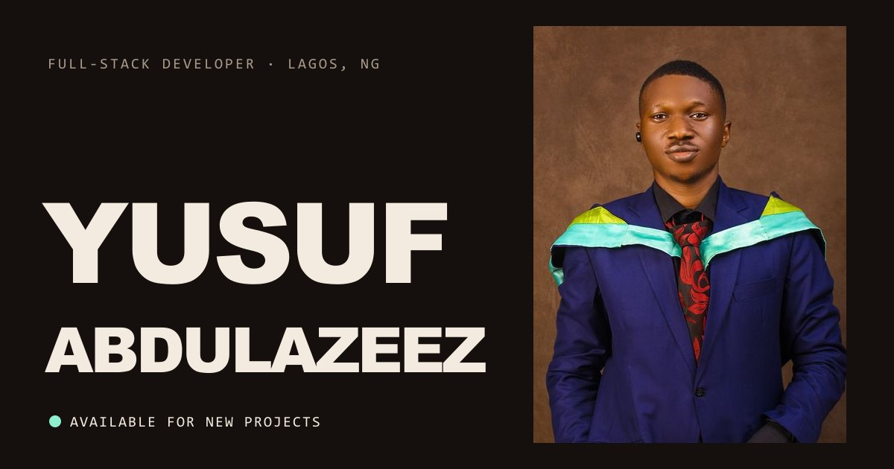

# Yussa — portfolio

My personal portfolio as a full-stack developer in Lagos, Nigeria.

**Live:** [yussa-port.vercel.app](https://yussa-port.vercel.app)



## Built with

- [React](https://react.dev) + [Vite](https://vite.dev)
- [Tailwind CSS v4](https://tailwindcss.com)
- [Motion](https://motion.dev) for animation
- [Lenis](https://lenis.darkroom.engineering) for smooth scrolling
- Hosted on [Vercel](https://vercel.com)

## Features

- Intro counter, letter-by-letter name reveal and scroll-triggered text animations
- Project cards that stack as you scroll on desktop, with a simple list on phones
- Live Lagos clock, rotating "available for work" badge and a custom cursor
- Expandable experience timeline, education and certifications, and a CV download
- Responsive from phone to wide desktop, keyboard friendly, and respects reduced-motion settings
- Social share image and meta tags for clean link previews

## Run it locally

```bash
npm install
npm run dev       # http://localhost:5173
npm run lint      # oxlint
npm run build     # production build into dist/
npm run preview   # serve the build locally
```

## Editing content

All the copy (intro, projects, experience, education, socials) lives in [`src/data.js`](src/data.js).
Change it there and every section updates.

| What | Where |
|---|---|
| Project screenshots | `public/images/work-<id>.webp` (1440px wide) plus a `-sm` version (720px) |
| Hero portrait | `public/images/yusuf-portrait.webp` and `-sm` |
| Passport photo (hero) | `public/images/yusuf-passport.webp` and `-sm` |
| About photo | `public/images/yusuf-suit.webp` and `-sm` |
| Contact photo | `public/images/yusuf-seated.webp` and `-sm` |
| CV | `public/Yusuf_Abdulazeez_CV.pdf` (replace the file, keep the name) |
| Link preview image | `public/og-image.jpg` (1200 × 630) |

## Structure

```
src/
  App.jsx              page layout, preloader, smooth scroll
  data.js              all site content
  lib/scroll.js        Lenis setup and scroll helpers
  components/
    Preloader.jsx      0 → 100 intro counter
    Nav.jsx            header, mobile menu, Lagos clock
    Hero.jsx           name, portraits, intro
    Marquee.jsx        scrolling skills strip
    About.jsx          story and animated stats
    Work.jsx           stacked project cards and earlier work
    Services.jsx       what I do
    Experience.jsx     roles, education, CV download
    Contact.jsx        contact and footer
    Reveal.jsx         scroll-reveal helpers
    Cursor.jsx         custom cursor (mouse only)
```

## Deploy

The repo is connected to Vercel, so every push to `main` deploys to
[yussa-port.vercel.app](https://yussa-port.vercel.app) automatically.

## Contact

- Email: [azeezyusufolamilekan159@gmail.com](mailto:azeezyusufolamilekan159@gmail.com)
- LinkedIn: [linkedin.com/in/yussamoney](https://www.linkedin.com/in/yussamoney)
- X: [@0xyussa](https://x.com/0xyussa)
